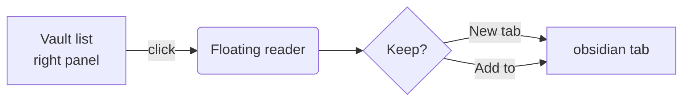
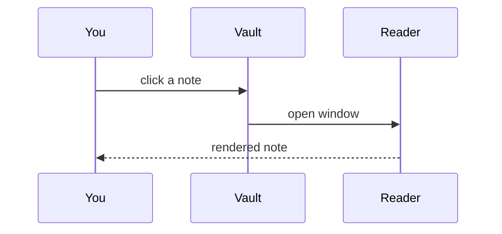

# Feature tour

Some **bold**, *italic*, ==highlighted==, ~~struck~~ and `inline code`, a tag #herdr and a nested tag #plan/reader. %%This comment is hidden.%%

Links: [[Other note]], [[Other note|an alias]], [[Other note#Section]], [[Other note#^blk|a block]], [[Missing note]] (unresolved), a [markdown link](Other%20note.md), [[plan]] from the root, and [an external site](https://obsidian.md).

## Callouts

> [!note]
> A plain note callout with a [[Other note|link]].

> [!warning]- Folded warning (click to open)
> Hidden until opened.

> [!tip]+ Open tip, foldable
> Nested:
> > [!example] Nested example
> > Inside a callout.

> [!success] Done
> - [x] shipped

## Tasks

- [ ] open task
- [x] done task
- [/] in progress
- [-] cancelled
- [>] forwarded
- [!] important

## Table

| Feature | Shown as |
|---|---|
| Mermaid | diagram image |
| Math | MathJax |

## Math

The energy is $E = mc^2$ and the sum is $\sum_{i=1}^{n} i = \frac{n(n+1)}{2}$, both inline.

$$
\int_0^1 x^2\,dx = \frac{1}{3}
$$

## Mermaid





## Embeds

![[Other note#Section]]

![[Other note#^blk]]

![[photo.png|320]]

![[Flow sketch.excalidraw]]

![[spec.pdf]]

![[Board.canvas]]

## Code and queries

```python
def hello():
    return "world"
```

```dataview
TABLE status FROM #herdr
```

Footnote reference[^1].

[^1]: The footnote text.
